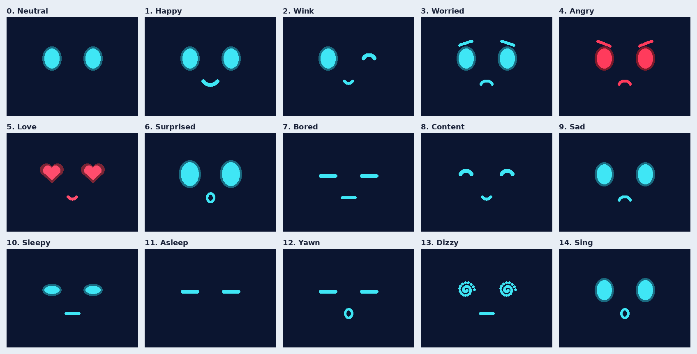

# Charmbot 🤖

A pocket robot companion built on the **ESP32-2432S028R** ("Cheap Yellow Display").
Desk dashboard today, 3D-printed bag charm tomorrow.



## What it does

**Swipe left/right** to move between apps. **Long-press anywhere** (even mid-game) to open the
**app wheel**: the robot face sits in the middle (tap it to go home), your apps orbit around it,
and the 🎮 **Games** folder opens a second ring with the games. Tap empty space or long-press again to close.

| App | What it shows |
|---|---|
| 🤖 **Face** (home) | Animated robot face with 14 expressions driven by a **mood engine**: it looks where you tap, gets annoyed if you spam it, loves being petted (swipe up/down), gets bored, sad and sleepy when ignored, bobs to your music, and dims itself at night. See [`docs/mood.md`](docs/mood.md). |
| 🕐 **Clock** | Big time + date, synced over WiFi |
| ⛅ **Weather** | Current conditions from Open-Meteo (no API key). Tap to refresh. |
| 🎵 **Spotify** | Now playing + progress, prev / play-pause / next |
| 📶 **WiFi** | Scan for networks, tap one, type the password on the on-screen keyboard. It's saved and used on every boot. |

**Games** (in the wheel's Games folder; they pause when you leave and keep your progress; best scores are saved across reboots)

| Game | Controls |
|---|---|
| 🐍 **Snake** | Swipe, or tap beside the snake's head, to turn |
| 🤖 **Flappy Bot** | Tap to fire the jetpack and fly through the gaps |
| 🔢 **2048** | Swipe to slide tiles; matching tiles merge. Tap **New** for a new game |

## Hardware

- ESP32-2432S028R (2.8" ILI9341 320×240 + XPT2046 resistive touch)
- Battery power: LiPo + TP4056 charger + 5 V boost + slide switch (full list in [`hardware/bom.md`](hardware/bom.md))
- 3D-printed robot-helmet case with a keyring loop

Pin map: [`hardware/wiring.md`](hardware/wiring.md) · **3D-printed case** (robot helmet with a keyring loop): [`hardware/case/`](hardware/case/README.md)

## Quick start

1. Install [VS Code](https://code.visualstudio.com/) + the **PlatformIO** extension.
2. Open the `firmware/` folder in VS Code.
3. Copy `firmware/include/config.example.h` → `firmware/include/config.h` and fill in your
   location and (optionally) Spotify details. WiFi can go here too, or you can pick a network
   on the device: long-press → **WiFi**.
4. Plug in the board and click **Upload** (→) in the PlatformIO toolbar.
   If the upload hangs on "Connecting...", hold the **BOOT** button until it starts.
5. Open the **Serial Monitor** (115200 baud) to see logs.

## Project layout

```
firmware/                 PlatformIO project
  include/                pins.h, config.example.h, theme.h
  src/core/               App base class, AppManager + AppWheel (navigation), Input (touch gestures),
                          Net (WiFi/NTP), Scores (saved high scores)
  src/apps/               FaceApp (+ FaceStyle.h), ClockApp, WeatherApp, SpotifyApp,
                          SnakeApp, FlappyApp, Game2048App
docs/                     face design guide + Canva template, Spotify setup, roadmap
hardware/                 wiring, case CAD/STL
tools/                    face_preview.py, spotify_auth.py
web/                      phone upload page (planned)
```

## Adding an app

1. Make a class that extends `App` (see `src/core/App.h`) in `src/apps/`.
2. Allocate big buffers in `enter()` and free them in `exit()`, since RAM is tight.
3. Give it a wheel icon by overriding `drawIcon()`.
4. Register it in `main.cpp` with `apps.add(&myApp);` and add it to `wheelApps` (or `wheelGames`
   if it's a game: also override `isGame()` to return true, and `resume()` to keep its state).

## Designing the face

See [`docs/face-design.md`](docs/face-design.md): Canva setup, shape rules, and how to map
your design onto `FaceStyle.h`. Preview without flashing:

```bash
pip install pillow && python3 tools/face_preview.py
```

## Troubleshooting

| Symptom | Fix |
|---|---|
| White or blank screen | Your board may have an ST7789 display. In `platformio.ini`, swap `ILI9341_2_DRIVER` for `ST7789_DRIVER`. |
| Colors inverted | Add `-DTFT_INVERSION_ON` (or `_OFF`) to `build_flags` |
| Touch is offset or mirrored | Set `TOUCH_DEBUG 1`, tap the corners, update the `TOUCH_*` min/max values |
| Upload fails / "Invalid head of packet" | Lower `upload_speed` in `platformio.ini` (460800, or 115200), hold BOOT while uploading, install the CH340 driver if no port shows up |
| "No WiFi" / network not listed | The ESP32 only sees **2.4 GHz** networks. Use the WiFi screen to see what it can find; a phone hotspot with "Maximize Compatibility" (iPhone) works |
| Spotify says "not set up" | Follow [`docs/spotify-setup.md`](docs/spotify-setup.md) (needs Spotify Premium) |

## Roadmap

Mood engine, phone photo/text uploads, motion reactions, battery, and the case:
see [`docs/roadmap.md`](docs/roadmap.md).
