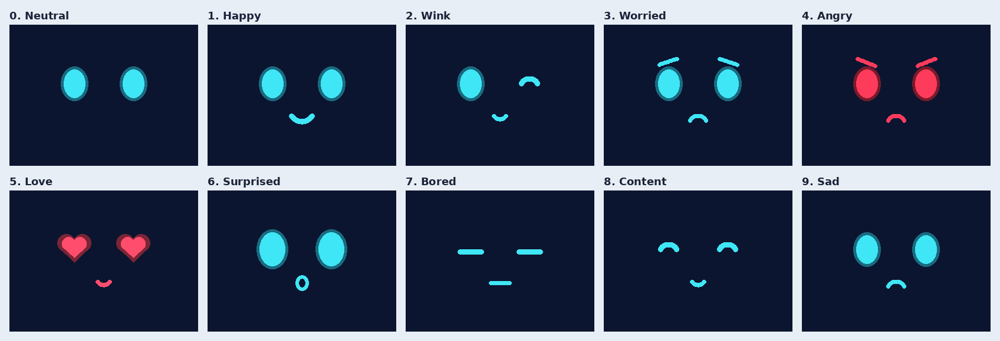

# Designing the face (Canva → code)

The robot face is **drawn in code** from simple shapes, not images. That's what lets it
blink, glance around and switch expressions smoothly, and it uses almost no memory.
Your Canva design is the blueprint; then you match the numbers in
[`firmware/src/apps/FaceStyle.h`](../firmware/src/apps/FaceStyle.h).



## Canva setup

1. **Custom size: 320 × 240 px.** That's the exact screen resolution.
2. Upload [`canva-template.svg`](canva-template.svg) and drop it on the page as a guide layer.
   It shows the eye positions, the mouth zone, and the **safe area**: keep everything inside the
   dashed box, because the eyes wander ±14 px sideways and ±8 px up/down.
3. Make **one page per expression**, using the same names as the code:
   Neutral, Happy, Wink, Worried, Angry, Love, Surprised, Bored, Content, Sad.
4. Delete the guide layer and export each page as PNG. Then run the preview script
   (below) and compare it with your exports.

## Shape rules (so the code can redraw it)

Stick to these building blocks. Anything made of them is easy to code:

| Part | Shapes available |
|---|---|
| Eyes | oval (with glow ring), closed arc `^`, flat line, heart |
| Brows | thick straight line, any angle |
| Mouth | arc (smile/frown, any size), small "o", flat line, none |
| Color | one main color plus a darker "glow" version of it per expression |

Things to avoid: gradients (the screen bands them), thin strokes under 4 px (hard to
see on a small screen), text, and photo or illustration textures.

## Current spec

| Thing | Value |
|---|---|
| Visor background | `#0B1530` |
| Eye color / glow | `#3FE6F5` / `#1A6A80` |
| Angry red / glow | `#FF3B5C` / `#7A1A2A` |
| Love pink / glow | `#FF4D6D` / `#7A2535` |
| Eye size | 36 × 48 px oval, 5 px glow ring |
| Eye centers (screen) | (110, 100) and (210, 100) |
| Mouth center (screen) | (160, 157) |
| Stroke width | 8 px (eyes), 6 px (mouths and brows) |
| Safe area | x 40–280, y 45–195 |

## Turning your design into code

- **Sizes, positions and colors:** edit `FaceStyle.h`. Canva colors are hex. Convert them to
  RGB565 with any "RGB565 converter" site, or ask Claude.
- **Changing an expression:** edit its row in the `EXPRESSIONS` table in `FaceApp.cpp`.
- **A brand-new expression** (sleepy, dizzy, music-bopping...): add it to the `Expression`
  enum in `FaceApp.h` and add a row to the table, in the same order.
- **A new part type** (for example, star eyes): add a case to `EyeShape` and draw it in `drawEye()`.

## Preview without flashing

```bash
pip install pillow
python3 tools/face_preview.py   # writes docs/face-preview.png
```

Keep the numbers in `tools/face_preview.py` in sync with `FaceStyle.h`.

## Animation ideas for later

- Look toward where you tap
- "Dizzy" spiral eyes when shaken (once the MPU-6050 is wired in)
- Bob to the beat while Spotify is playing
- Slowly get sleepy when nobody touches it
