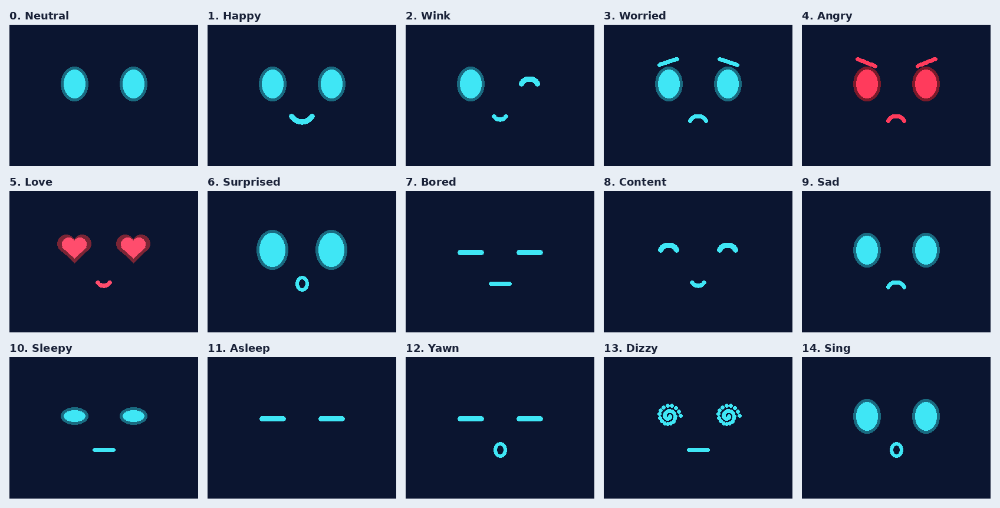

# Mood engine

The face isn't a loop of animations. It reacts to what happens. All of this lives in
`src/apps/FaceApp.cpp` (choosing expressions) and `src/core/Mood.cpp` (happiness).



## Reactions

| You do / it notices | Reaction |
|---|---|
| Tap the face | Blinks and looks where you tapped (+ a little happiness) |
| Tap 5 times within 3 s | Angry brows, "!!" bubble |
| Swipe up/down on the face (petting) | Content ^‿^ eyes |
| Pet 3 times within 8 s | Love eyes + heart bubble |
| Just hanging out | Every 15–40 s: a random emote (wink, ^‿^, surprised, heart eyes, singing) or it puts on an accessory for a few seconds: bow, halo, sunglasses, crown or flower (see `accessories-preview.png`) |
| Nobody touches it for 3 min | Bored, with little z's floating up |
| ...7 min | Sad |
| ...10 min (`SLEEP_AFTER_MIN`) | Falls asleep: eyes closed, floating z's + Zzz bubble, screen dims, slow breathing |
| Touch it while asleep | Surprised, then happy |
| A Spotify song starts | Surprised, then it **dances**: bounces on the beat, sways, tilts its head, cycles through happy / ^‿^ / singing / wink / love moves, with music notes floating up (see `dance-preview.gif`) |
| Beat a high score | Love eyes when you come back home |
| Lose a game | Worried face when you come back home |
| Midnight to 6 am (`NIGHT_START_HOUR`/`NIGHT_END_HOUR`) | Sleepy half-closed eyes, yawns now and then |
| WiFi drops | Worried face + WiFi bubble |
| Rainy weather* | Neutral face + rain bubble. Sunny shows a sun bubble |
| Room goes dark (light sensor, after calibrating) | Falls asleep and dims; yawns awake when the lights come on |
| Shake it (tilt switch, optional) | Dizzy spiral eyes |

\* Weather comes from the Weather app, so open it once after boot.

Long-press still opens the app wheel, and left/right swipes still change apps. Petting is
**up/down** so it doesn't clash with them.

Overall happiness (0–100) goes up when you interact, pet it, or set high scores, and down
when you spam it, lose, or ignore it. It sets the resting face: happy, neutral or sad.

## Options (add to `config.h` to change)

```c
#define NIGHT_START_HOUR 0   // sleepy from...
#define NIGHT_END_HOUR   6   // ...until
#define SLEEP_AFTER_MIN  10
```

## Light sensor (dark room → sleep)

The CYD's light sensor is on IO34, but boards differ in which direction the reading goes,
so it's off until you calibrate it:

1. Add `#define LIGHT_DEBUG 1` to `config.h`, upload, and open the Serial Monitor.
2. Note the `[light]` number in normal light, then cover the sensor (the little component
   near the screen edge, often next to the RGB LED) with your finger.
3. Pick a threshold halfway between the two numbers:
   ```c
   #define LIGHT_DARK_THRESHOLD 300    // your halfway value
   #define LIGHT_DARK_WHEN_ABOVE 1     // 1 if covering it made the number go UP, 0 if DOWN
   #define LIGHT_DEBUG 0
   ```

Some CYD boards have a light sensor that barely changes. If the numbers hardly move, skip this.

## Shake detection (tilt ball switch)

If your kit has a tilt ball switch (a small black cylinder with 2 legs that rattles):

1. Connect one leg to **IO22** and the other to **GND**, using the CN1 connector
   (pins: GND, IO22, IO27, 3.3V).
2. Add `#define TILT_PIN 22` to `config.h`.

Shaking it 6 times within about a second triggers the dizzy face.

An MPU-6050 (GY-521) would add real tilt detection (eyes sliding downhill). It isn't in the
Super Starter Kit, but it's about $5–8 and wires to IO22/IO27 over I²C.

## Adding your own reactions

1. Add an expression: a new name in the `Expression` enum (`FaceApp.h`) and a row in
   `EXPRESSIONS` (`FaceApp.cpp`).
2. Trigger it: call `react(Expression::YourFace, milliseconds, Bubble::Something)` from
   `handleInput()` or `checkSensors()`.
3. From another app, report an event with `Mood::event(...)` and handle it in
   `FaceApp::enter()`.
