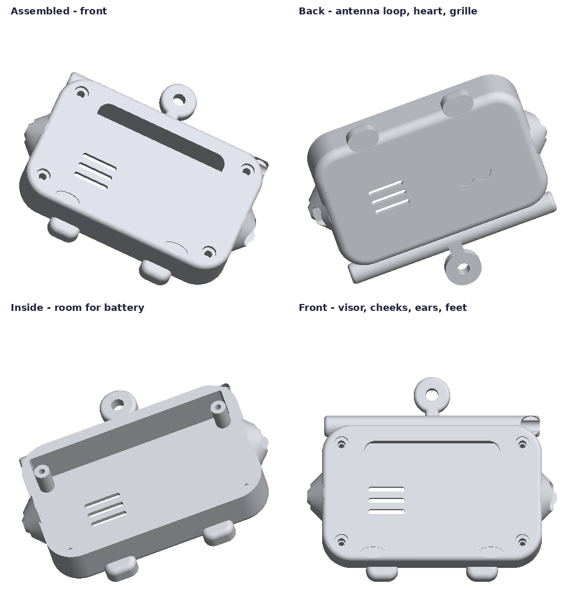

# Charmbot case (v2: cute edition)

A squishy robot-helmet shell. The screen is the visor, with big headphone ears, an
**antenna-ball loop on top for a keyring / lobster clasp**, blush cheeks, little feet,
a heart on the back, and a **battery bay** under the board.



| File | What | Print orientation |
|---|---|---|
| `stl/fit_test.stl` | 1.2 mm frame matching the board outline, screen window and holes | flat, ~10 min. **Print this first** |
| `stl/case_back.stl` | shell + battery bay, ears, antenna loop, feet, heart, speaker grille, USB / charge-port / switch openings | **back face down** (loop lies flat on the bed) |
| `stl/case_front.stl` | visor bezel with blush cheeks and 4 screw bosses | **front face down** |
| `cad/*.step` | the same parts for Fusion 360 / Onshape / FreeCAD | - |
| `charmbot_case.py` | parametric source: every dimension and cute feature at the top | - |

No supports needed. The ears are tapered at 45°, the loop prints flat, and the feet grow straight up from the bed.

**Size:** body 97 × 61 mm, **22.4 mm thick** with the battery bay
(106 × 85 mm including ears, feet and antenna).
For a slimmer USB-powered desk version, set `BATTERY_SPACE = 0` (16.4 mm thick).

**Parts to buy** (battery, charger, boost, switch, screws): see [`../bom.md`](../bom.md).

## Openings
- **Right side:** the board's USB port, for uploading code
- **Left side:** USB-C for the battery charger (TP4056)
- **Bottom edge, between the feet:** slot for an SS12D00 slide switch
- **Back:** speaker grille (left) and heart (right)
- **Top edge:** a "headband" tube that holds the **stylus**. It slides in from the right end and
  friction holds it. Pinch it out at the thumb notch.

## Assembly
1. Stick the battery, charger and boost board into the bay with foam tape (layout in `bom.md`).
   Line the charger's USB-C up with the left opening and the switch with the bottom slot.
2. Cover them with Kapton tape, then lay the CYD face-up on the 4 standoffs.
3. Put the bezel on. Its bosses sit on the board's corner holes.
4. Drive 4× **M3 × 16 mm** self-tapping screws through the bezel and board into the standoffs. Snug, not tight.
5. Add a split ring + lobster clasp to the antenna ball.

**Make it cute:** paint the cheek recesses pink (or use small round stickers), and fill the heart on the back with paint or nail polish.

## ⚠️ Fit check first

These numbers are the typical CYD (86 × 50 mm, M3 corner holes), but boards vary.
Print `fit_test.stl` and lay it on your board:

- **Holes don't line up?** Set `HOLE_INSET`.
- **Lit screen not centered in the window?** Set `SCREEN_DX` / `SCREEN_DY`.
- **USB notch in the wrong place?** Set `USB_SIDE` / `USB_DY`.
- **Board taller than ~11.3 mm** (glass to tallest back part)? Raise `BACK_PARTS_H`.
- **Battery thicker than 5 mm?** Raise `BATTERY_SPACE`.
- **Stylus:** measure its thickest point and set `STYLUS_D`. Too loose? Lower `STYLUS_FIT`.
  Too tight? Raise it. Set `STYLUS_OPEN_SIDE = -1` to insert from the left instead.

Then regenerate the files:

```bash
pip install cadquery
cd hardware/case
python3 charmbot_case.py
```

**Print settings:** PETG (or PLA), 0.2 mm layers, 4 walls on the back part (strong loop), 20% infill.
